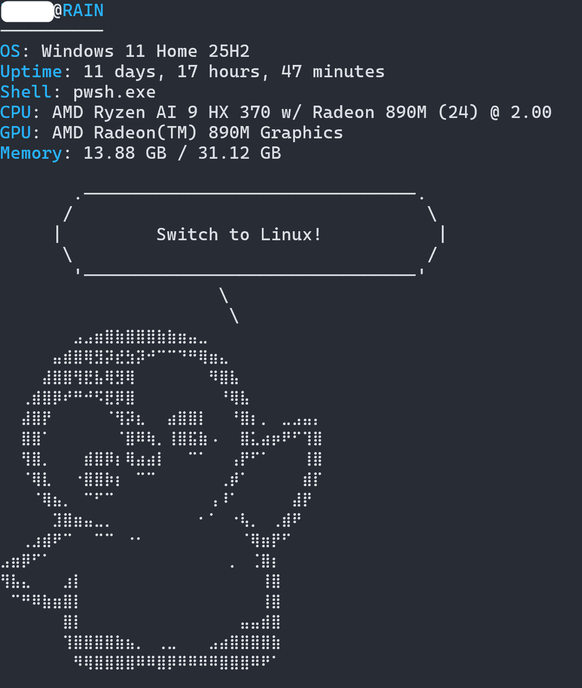

# winfetch

A minimal utility inspired by [neofetch](https://github.com/dylanaraps/neofetch) that displays Windows system information in the terminal.

Written in C and built on the Win32 API, with no external dependencies at runtime.



## Building

### Requirements

- [MinGW](https://www.mingw-w64.org/) (GCC)
- [CMake](https://cmake.org/)

Make sure both are present in your `PATH`.

### Steps

From the root of the project, run the build script in PowerShell:

```powershell
.\build.ps1
```

## Usage

```powershell
.\build\winfetch.exe
```
